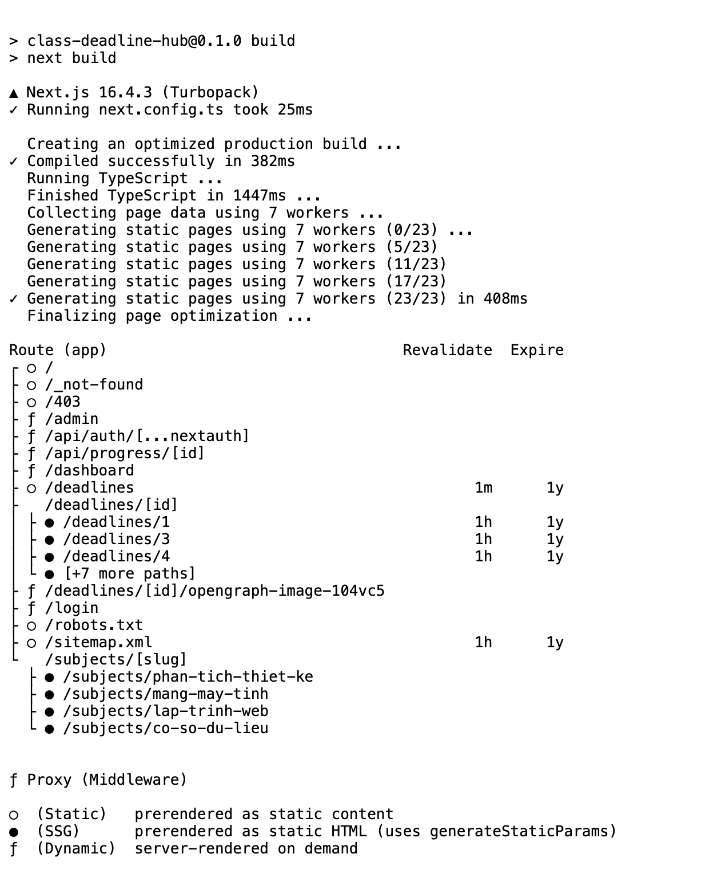
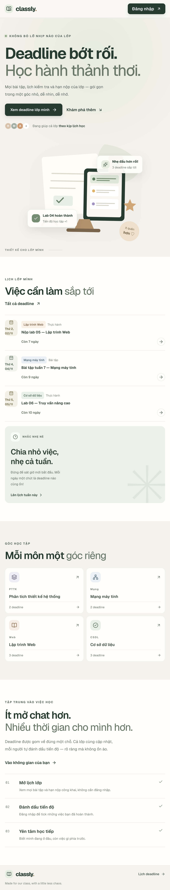
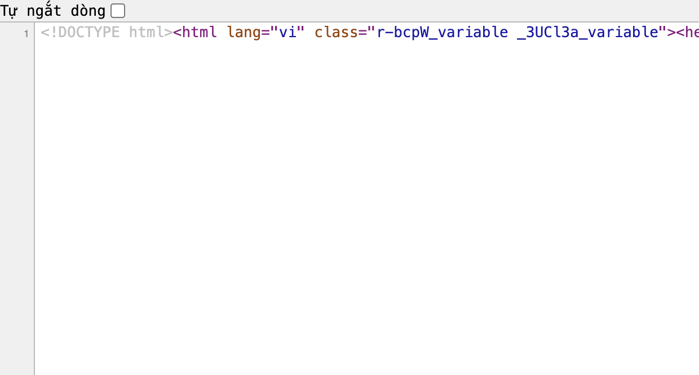
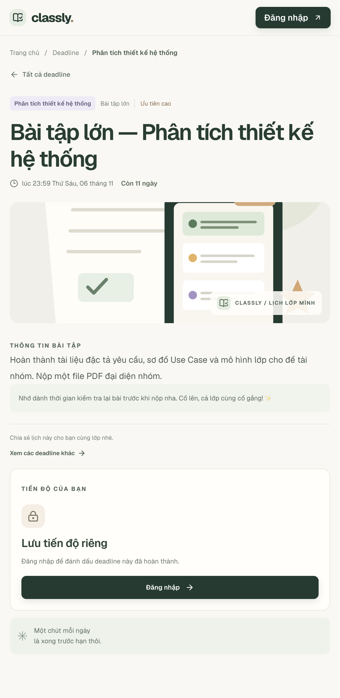

# Classly — Class Deadline Hub

Một góc nhỏ để cả lớp theo dõi bài tập, lịch kiểm tra và hạn nộp. Ứng dụng dùng Next.js App Router, Auth.js (Credentials + JWT) và dữ liệu JSON trên server.

## Chạy ứng dụng

Yêu cầu Node.js 20.9 trở lên.

```bash
npm install
AUTH_SECRET="$(openssl rand -base64 32)" AUTH_TRUST_HOST=true npm run dev
```

Mở [http://localhost:3000](http://localhost:3000). Để chạy bản production:

```bash
npm run build
AUTH_SECRET="$(openssl rand -base64 32)" AUTH_TRUST_HOST=true npm run start
```

Khi deploy, hãy cấu hình `AUTH_SECRET` bằng secret ngẫu nhiên riêng cho môi trường và `AUTH_TRUST_HOST=true` nếu ứng dụng nằm sau proxy tin cậy. Đặt `NEXT_PUBLIC_SITE_URL` thành URL công khai của website để sitemap, robots, metadata và structured data sinh đúng địa chỉ.

### Tài khoản demo

| Email | Mật khẩu | Vai trò |
|---|---|---|
| `admin@ptit.edu.vn` | `admin123` | Lớp trưởng / admin |
| `sv@ptit.edu.vn` | `sv123456` | Sinh viên |

Đây là thông tin đăng nhập phục vụ bài tập; không dùng cách lưu mật khẩu hard-coded này cho sản phẩm thật.

Deadline được lưu trong [`data/deadlines.json`](./data/deadlines.json), trạng thái hoàn thành cá nhân trong [`data/progress.json`](./data/progress.json). Bộ dữ liệu hiện có 10 deadline mẫu; có thể bổ sung bằng tài khoản admin. JSON trên filesystem phù hợp với bản demo chạy Node có ổ đĩa ghi được; khi dùng serverless hoặc nhiều instance cần thay bằng kho lưu trữ dùng chung.

## Rendering theo route

| Route | Rendering | Cách triển khai |
|---|---|---|
| `/` | SSG | Trang chủ được prerender trong build; dữ liệu mẫu đọc từ JSON. |
| `/subjects/[slug]` | SSG | `generateStaticParams` tạo trước 4 trang môn học. |
| `/deadlines` | ISR, 60 giây | `revalidate = 60`; bộ lọc tương tác nằm trong Client Component. |
| `/deadlines/[id]` | ISR, 1 giờ + on-demand | `generateStaticParams` tạo sẵn deadline hiện có; `revalidate = 3600`; Server Actions gọi `revalidatePath` sau thêm/xoá. |
| `/dashboard` | SSR | `force-dynamic`, lấy session và tiến độ theo từng request. |
| `/admin` | SSR | `force-dynamic`, xác thực admin tại page và kiểm tra quyền lần nữa bên trong từng Server Action. |

Trang chi tiết mới thêm sẽ được tạo theo yêu cầu; deadline bị xoá trả về `notFound()` và giao diện 404 dùng chung của dự án.

## Kết quả kiểm tra production

Đã chạy `npm run lint` thành công và `npm run build` thành công. Tóm tắt route trong kết quả build:

```text
○ /                                      Static
○ /deadlines                             Static + revalidate 60s
● /deadlines/[id]                        SSG params from JSON + revalidate 1h
● /subjects/phan-tich-thiet-ke           SSG
● /subjects/mang-may-tinh                SSG
● /subjects/lap-trinh-web                SSG
● /subjects/co-so-du-lieu                SSG
ƒ /dashboard                             Dynamic / SSR
ƒ /admin                                 Dynamic / SSR
```

`○` là trang tĩnh; `●` là trang tĩnh sinh qua `generateStaticParams`; `ƒ` là trang render động. Trang Open Graph theo từng deadline được sinh động để ảnh xem trước khớp nội dung được chia sẻ.

Ảnh bằng chứng build, giao diện và HTML source:









## Lighthouse

Đo bằng Lighthouse CLI 13.5.0 trên **bản production** tại `http://127.0.0.1:3000` với Google Chrome 156.0.8078.48 (headless):

| Route | Performance | Accessibility | Best Practices | SEO |
|---|---:|---:|---:|---:|
| `/` | **96** | **95** | **100** | **100** |
| `/deadlines/1` | **96** | **95** | **100** | **100** |

Điểm có thể dao động theo phiên bản Chrome và môi trường chạy. Có thể đo lại sau khi khởi chạy production:

```bash
npm run build
AUTH_SECRET="local-lighthouse-secret" AUTH_TRUST_HOST=true npm run start
# Ở terminal khác:
npx lighthouse http://localhost:3000/ --view
npx lighthouse http://localhost:3000/deadlines/1 --view
```

## SEO và chia sẻ

- Metadata riêng cho từng deadline, Open Graph/Twitter card và ảnh PNG tạo bằng `ImageResponse`.
- Sitemap liệt kê trang chủ, lịch deadline và từng deadline; robots cho phép trang công khai nhưng chặn `/dashboard` và `/admin`.
- `/login`, `/dashboard` và `/admin` có metadata `noindex`.
- Chi tiết deadline có structured data `BreadcrumbList`; route không tồn tại dùng `notFound()`.
- Dùng `next/font` với `latin-ext` để hiển thị tiếng Việt, `next/image` cho ảnh minh hoạ.

## Hai câu hỏi

**1. Vì sao `/deadlines/[id]` dùng ISR?**  
Chi tiết deadline cần HTML dựng sẵn để tải nhanh và chia sẻ/SEO tốt, nhưng dữ liệu vẫn có thể thay đổi. ISR cho phép phục vụ bản đã tạo, làm mới theo chu kỳ và tái tạo đúng route ngay sau khi admin thêm hoặc xoá deadline, không cần build lại toàn bộ website.

**2. Nếu chỉ dùng Middleware để bảo vệ `/admin` thì có rủi ro gì?**  
Middleware chỉ là lớp điều hướng sớm, không phải ranh giới bảo mật đầy đủ. Server Action có thể được gọi trực tiếp bằng POST mà không đi qua luồng UI dự kiến; nếu action không tự xác thực và kiểm tra quyền, user có thể gọi thao tác thêm/xoá trực tiếp. Vì vậy trang admin và mọi Server Action đều tự gọi `auth()` rồi kiểm tra quyền qua `can(role, action)`.
